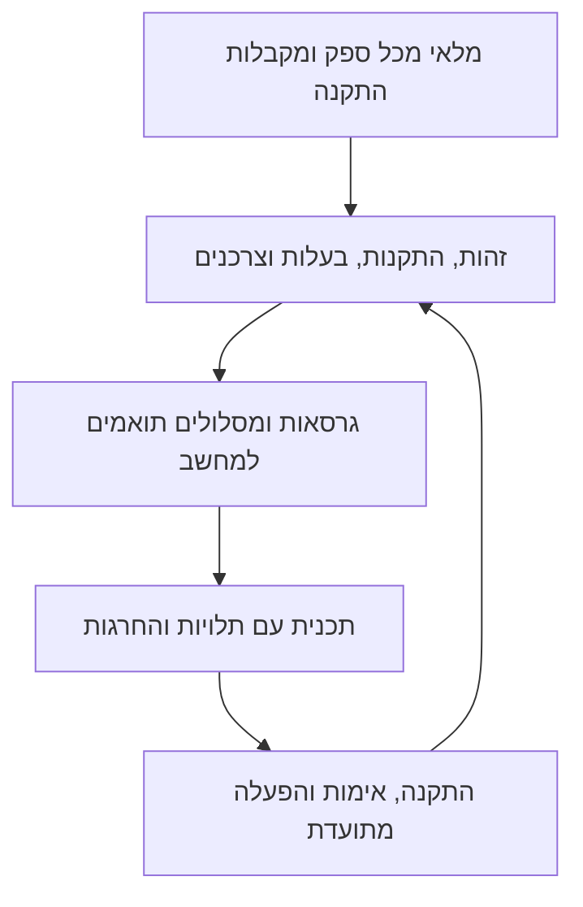

# מיפוי ותכנית למנהל עדכונים המתאים למחשב שלך

נבדק ב־19.10.2026 עבור macOS 26.7.1, ‏Intel Core i9-9980HK, ‏x86_64 ו־16GiB זיכרון. זהו תוצר מיפוי ותכנון; לא בוצעו במסגרתו התקנות, הסרות, עדכונים או מעברי ספק.

**ההמלצה:** להמשיך מהאפליקציה הקיימת ולהפוך אותה בהדרגה למנהל של ספקי חבילות. תחילה לתקן מלאי, זהות ובעלות על התקנות; לאחר מכן להוסיף גילוי גרסאות עצמאי, תכנון תלות ואימות; ורק אז להרחיב העברה למסלולים מהירים. רשימת שמות נוספת בקוד אינה מספיקה לטיפול בחבילות עתידיות.

## מה נמצא במחשב

| תחום שנבדק | ממצא | משמעות לתכנון |
|---|---|---|
| Homebrew | 233 חבילות formula ו־7 casks: סך הכול 240 זהויות חבילה, כולל ngrok המוחרג | האפליקציה מציגה 238; שתי חבילות MongoDB חסרות בה |
| התקנות חלופיות של המנהל | Node, Deno, Ansible, uv ו־Pandoc | חמש התקנות נוספות של כלים שכבר קיימים גם ב־Homebrew; חייבות רשומות בעלות נפרדות |
| קשרי תלות | 480 קשרים ישירים בקבלות של כלל הגרסאות שנשמרו; 438 בהתקנות הפעילות | לא לתכנן כל ספרייה כעדכון עצמאי; קבלה אינה בדיקת קישור בזמן ריצה |
| כוונת התקנה | 51 הותקנו לבקשת משתמש, 101 מסומנות כתלות, 81 ללא סימון תלות מספיק | אין להסיק מ־81 הרשומות הלא ודאיות שהן מיותרות |
| npm גלובלי | 10 חבילות תחת `/usr/local` | Node החדש עדיין משתמש ב־prefix הגלובלי הקודם; מעבר runtime אינו מעבר של כל כלי npm |
| כלי uv ו־pipx | NotebookLM CLI דרך uv; imagesorcery-mcp בסביבת pipx קיימת | חבילות שהאפליקציה אינה מנהלת; pipx עצמו אינו ב־PATH ולכן גילוי פקודות בלבד מפספס אותן |
| Ruby | 48 זהויות gem, כולל חבילות מערכת | צריך להבחין מערכת/משתמש לפני הגדרת סמכות עדכון |
| אפליקציות macOS | 63 חבילות app בתיקיות הראשיות שנבדקו | בעלות App Store/מעדכן עצמי/מתקין אינה מוכחת לכל אחת |
| Bun | runtime קיים; רשימת global אמינה לא הושגה | המצב יישאר לא ידוע עד שייבנה מתאם עם scope מפורש |

המספרים מתייחסים לתחומים שונים וחלקם חופפים; אין לחבר אותם למספר אחד של ״כל התוכנות״. רשימת Homebrew אומתה גם מול קבלות Cellar; שאר הגילוי היה ממוקד בנתיבי התקנה רגילים ובמלאי הספקים. לא נסרקו כל הפרויקטים ותיקיית הבית באופן רקורסיבי. ראו [המלאי וההסתייגויות](inventory/README.md).

## תקלות ופערים שמשנים את סדר העבודה

1. **MongoDB אינו במלאי האפליקציה:** קבלות מוכיחות `mongodb-community` 8.2.9 ו־`mongodb-database-tools` 100.16.1. הסיבה להשמטתן מ־brew info לא הוכרעה; יש אזהרת tap לא מהימן בראיות הריצה הקודמת. אין לשנות trust אוטומטית. קבלת MongoDB דורשת גם mongosh, שלא נמצא בנתיבי ההתקנה שנבדקו.
2. **LLVM מוצג באופן מטעה:** האפליקציה מציגה 23.1.3_2 כמותקן, אך תיקיית הגרסה ריקה וללא קבלה. יעד opt הפעיל הוא 22.1.5. צריך להבחין בין גרסה תקינה, ניסיון התקנה ותיקייה שנותרה.
3. **התקנה פעילה והתקנת Homebrew מתמזגות לשורה אחת:** הצלחת Node החדש אינה מתקנת את Node הישן או ספריותיו. גרסת כלי פעילה לא צריכה להסתיר תקלה או עדכון של התקנה שעדיין משמשת צרכנים אחרים.
4. **כלים חלופיים עדיין נשענים על Homebrew לגילוי גרסה חדשה:** אם התקנת Homebrew תוסר, כלי מנוהל יכול להיעלם מהמלאי. לכל ספק נדרש גילוי התקנות וגרסאות משלו.
5. **הפעלה וחזרה לאחור אינן עסקה שלמה:** קיימת החלפה אטומית של symlink, אך כתיבת הפקודות והרישום מתבצעת אחריה בכמה צעדים. נדרשים אימות מלא, יומן שלבי הפעלה והתאוששות לאחר עצירה באמצע.

בעיות קישור ב־merve, LLVM ו־Node הישן נמדדו בריצה הקודמת; לא הורצה במיפוי זה סריקת linkage חדשה. גם 296 דרישות לגרסאות בקבלות שלא נמצא להן קג באותה גרסה אינן 296 תקלות מוכחות: חלקן היסטוריות וחלקן עשויות להסתפק בגרסה תואמת חדשה יותר.

## מה עושים עם 27 העדכונים שנדחו

[המטריצה המפורטת](routes/matrix-table.md) כוללת לכל אחד גרסה מבוקשת, סיבה, מקור ותאריך ראיה, מועמדים ופעולת האימות הבאה. גם [JSON](routes/deferred-route-matrix.json) וגם [TSV](routes/deferred-route-matrix.tsv) נשמרו. אין מועמד שסומן כאן כהתקנה חדשה שנבדקה בהרצה.

| קבוצת עבודה | דוגמאות והקשרים | הצעד הבא |
|---|---|---|
| פקודות עצמאיות יחסית | socat, wget, Nmap | לבדוק מסלול מוכן, אפשרויות שימוש ונתיב הפעלה; להתחיל בפיילוט מדיד |
| שילוב עם האפליקציה | terminal-notifier | קיים release מועמד; לבדוק שינויי אפשרויות והתראה מהאפליקציה הארוזה |
| PDF והצפנה | Poppler, GnuPG, GPGME/GPGMEPP, NSS, p11-kit, Unbound, OpenJPEG | לבחור סביבת כלי עם גרף תלויות שלם; לשמור תלויות ישנות עד שזוהו צרכניהן |
| OCR | Tesseract, Pango, OpenJPEG ונתוני שפות | בדיקת עברית/אנגלית ו־traineddata; פקודת OCR וספריית libtesseract הן שימושים שונים |
| PHP | PHP, Net-SNMP, OpenLDAP | לבדוק extensions, תצורה, פרויקטים ו־FPM; מעבר אינו החלפת executable בלבד |
| מהדרים ו־MPI | LLVM/IWYU; Open-MPI וצרכני ARPACK/igraph | סביבה תואמת ובדיקת פרויקט; קודם לתקן תמונת מצב LLVM |
| Python | cryptography, Pycairo | לזהות interpreter ו־ABI; חבילה בסביבה חדשה אינה מעדכנת imports בסביבה הישנה |
| Node הישן | merve, simdjson | לאבחן את הצרכנים שנשארו ב־Homebrew, כולל קשרי MongoDB; אין להסיר לפי PATH בלבד |
| שירותים ונתונים | PostgreSQL; גם MongoDB שזוהה מחוץ ל־27 | נתיבי נתונים קיימים. לברר שימוש, הרחבות, שירות, גיבוי ושחזור לפני מעבר ספק |
| מודלים וכלים ללא מסלול מוכח | libtensorflow, whisper.cpp | לבדוק זמינות לגרסת היעד ותאימות מודלים. גרסה ישנה יותר אינה השלמת עדכון |

הקבוצות חופפות בתלויותיהן; המטריצה כוללת בדיוק 27 פריטים, ללא ספירה כפולה. נבחנו גם ארכיוני MacPorts וקבצים רשמיים, אך קיום ארכיון אינו פתרון של כל התלויות. פתרונות Pixi מתועדים מ־18.10 מסומנים כראיה היסטורית; בדיקות metadata חדשות מ־19.10 מסומנות בנפרד. במיוחד, פתרונות Poppler ו־Whisper הישנים אינם מגיעים לגרסאות היעד הנוכחיות. [מקורות ופרטי המסלולים](routes/README.md).

## איך המערכת תטפל גם בחבילות עתידיות

לכל ספק יהיה מתאם בעל יכולות מפורשות: גילוי, גרסאות, השוואה לפי כללי הספק, פתרון תלויות, התקנה ואימות. חבילה חדשה המותקנת אצל ספק נתמך תתגלה בבדיקה הבאה, בלי להוסיף את שמה לרשימה בקוד. שני prefixes של אותו ספק הם שתי התקנות שונות. התקנה ידנית או ספק לא נתמך יופיעו ככאלה; שם executable אינו מספיק כדי להמציא מסלול עדכון.

העדכון הרגיל נשאר אצל הבעלים הקיים. מעבר ספק נעשה כתכנית נפרדת על סמך תאימות וצרכנים. לפני בחירת מסלול בודקים: החרגות, אמינות המקור, Intel/macOS ודרישות runtime, טווח גרסאות וערוץ, תלויות ונתונים. מהירות נמדדת רק בין מסלולים שעברו את התנאים האלה. אין לשנמך או לעבור לגרסה ראשית אחרת כדי לקבל קובץ מוכן.

Homebrew, Pixi, uv ומקורות רשמיים שכבר קיימים הם הבסיס הראשון. מוסיפים גילוי npm גלובלי ו־pipx/uv tool בעקבות הממצאים במחשב. MacPorts יישאר ספק מועמד עד לבדיקת היקף התאימות והערך שלו; אין צורך להתקין את כל המנהלים. תלויות פרויקט ייסרקו רק בפרויקטים שהוגדרו, עם מדיניות lockfile ובדיקות משלהן. [גבולות ומדיניות מפורטים](scope-and-policy.md), [יכולות הספקים](routes/providers.md).

## סדר מימוש מומלץ ותנאי סיום

| שלב | שינוי | איך נוכיח שהושלם |
|---|---|---|
| 1. מלאי ובעלות | הפרדת תוכנה/התקנות/פקודות; איחוד גילוי וקבלות; מצב unknown ושגיאות ספק | שני פריטי Mongo מופיעים; חמש התקנות חלופיות קיימות ללא שורת Brew; כשל ספק אינו מעלים התקנות |
| 2. גרסאות ומדיניות | קטלוג לכל ספק, גרסה ראשית/ערוץ/pin, פתרון בינארי מלא לפני ready | גרסה חדשה אצל ספק מזוהה גם אם Brew מפגר; אין קפיצה ראשית או תלות wheel חסרה בזמן ההתקנה |
| 3. תכנית תלויות | מזהה תכנית, פעולות ותלויות מדויקות, בדיקה חוזרת לפני שינוי | שינוי מדיניות/מלאי/lock פוסל תכנית; תלות מוחרגת אינה מתעדכנת בעקיפין; כשל משותף אינו מורץ שוב לכל צרכן |
| 4. אימות והתאוששות | הפעלה מדורגת, בדיקת כל הפקודות, רישום כל שלב, נעילה בין תהליכים | עצירה בכל גבול שלב משאירה מצב מזוהה; התנגשות פקודות נעצרת; חזרה לגרסה קודמת נבדקת |
| 5. הרחבת הכיסוי | גילוי ועדכון npm/uv/pipx והרחבת פיילוטי CLI | כלי עתידי אצל ספק נתמך מופיע בלי שינוי רשימת שמות; scope וקשר ל־runtime נשמרים |
| 6. קבוצות מורכבות ותפעול | PDF/OCR/מהדרים ושירותים; ניהול runtime של האפליקציה | בדיקות צרכנים ותוצאות אמיתיות; מעבר נתונים דורש בדיקת שחזור; Python/Pixi/uv הפנימיים נבדקים בנפרד מכלי המשתמש |

בכל השלבים נשמרת החרגת `ngrok` במלאי ובכל כניסות העדכון, כולל תלות עקיפה ומעבר בין ספקים. שלבים 1–4 קודמים להרחבה אוטומטית של מעברי ספק. אפשר להוסיף מלאי תצפיתי של ספק חדש מוקדם יותר, בלי להעניק לו סמכות שינוי. [תכנון טכני עם הפניות לקוד ובדיקות קבלה](architecture/design.md).

## מה כבר מוכן לשלב המימוש

- [מטריצת 245 רשומות התקנה](installation-plan-matrix.tsv): 240 זהויות Homebrew ועוד חמש התקנות חלופיות, עם בעלות, תפקיד, צרכנים, מסלול מועמד ופעולה הבאה. גרסאות קג שמורות מקוננות ברשומה; אין כאן טענה ל־245 תוכנות ייחודיות או לכיסוי כל אפליקציות המחשב.
- [אותה מטריצה ב־JSON](installation-plan-matrix.json), [המלאי הגולמי](inventory/homebrew-rows.json) ו־[הגרף הישיר](inventory/homebrew-direct-edges.json).
- [כלים גלובליים נוספים](inventory/other-package-rows.json), [אפליקציות](inventory/native-apps.json), [שירותים ונתיבי נתונים](inventory/services.json).
- [תוצאת בדיקת עקביות](validation.json): זהויות ייחודיות, כיסוי 27 הדחיות, הפרדת חמש ההתקנות ושמירת ngrok מוחרג. זו בדיקת נתוני המיפוי; לא benchmark ולא אימות התקנה.

העבודה חולקה לשלושה סוכנים ממוקדים: מלאי מקומי, מסלולים ל־27 הדחיות, וארכיטקטורה. כל אחד קיבל הקשר ממוקד בלבד, במודל Sol 6.1 וברמת reasoning גבוהה. לא הורצו מחדש פתרונות התלויות המקיפים מאתמול. התוצרים אוחדו מקבצים שמורים. אין מדידת טוקנים שמוכיחה כאן חיסכון; בהמשך רצוי לשמור reasoning גבוה לניתוח ארכיטקטורה/תאימות, ולהשתמש ברמה נמוכה יותר לאיסוף נתונים מובנה ולבדיקות עקביות.

השינויים בתור הנוכחי הם מסמכי תכנון ונתוני בדיקה. התנהגות צדדית של פקודות מלאי ישנות, ובהן ניקוי רשומות cache ב־uv ובדיקת Bun שבחרה scope שגוי, מתועדת במלאי; לא נמצא שינוי מתמשך ב־lockfile בעקבות Bun ולא בוצעו פעולות התקנת חבילות.
